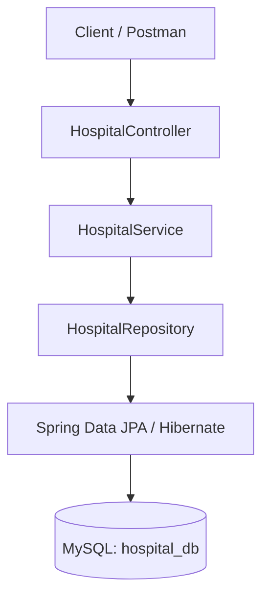

# 🏥 Hospital Management System

<p align="center">
  <strong>A REST API application built using Java and Spring Boot</strong>
</p>

<p align="center">
  
  
  
  
</p>

## 📌 Table of Contents

- [About the Project](#-about-the-project)
- [Features](#-features)
- [Technology Stack](#-technology-stack)
- [Application Architecture](#-application-architecture)
- [Project Structure](#-project-structure)
- [Database Configuration](#-database-configuration)
- [Getting Started](#-getting-started)
- [API Documentation](#-api-documentation)
- [Testing with Postman](#-testing-with-postman)
- [Troubleshooting](#-troubleshooting)
- [Future Enhancements](#-future-enhancements)

## 📖 About the Project

The **Hospital Management System** is a backend application developed using Java and Spring Boot. It provides REST API endpoints to manage hospital records and demonstrates how a Spring Boot application communicates with a MySQL database.

The project helped me practise backend development concepts such as REST APIs, controller methods, service and repository layers, entity classes, and database connectivity.

## ✨ Features

- ✅ Add hospital records.
- ✅ Retrieve hospital records.
- ✅ Delete hospital records by ID.
- ✅ Integrate Spring Boot with MySQL.
- ✅ Handle HTTP requests using REST endpoints.
- ✅ Organize backend code using a layered architecture.

*The features listed above reflect the functionality discussed for this project. Additional features can be included as they are implemented.*

## 🛠️ Technology Stack

| Technology | Purpose |
|---|---|
| Java | Core programming language |
| Spring Boot | Backend application framework |
| Spring Web | REST API development |
| Spring Data JPA | Database access and persistence |
| Hibernate | ORM implementation |
| MySQL | Relational database |
| Maven | Dependency management and build tool |
| Postman | API testing |

## 🏗️ Application Architecture

The application follows a layered backend architecture.



### How it works

1. The client sends an HTTP request.
2. The controller receives and processes the request.
3. The service layer handles the business logic.
4. The repository communicates with the database through JPA.
5. MySQL stores or retrieves the hospital records.
6. The API returns an HTTP response to the client.

## 📂 Project Structure

```text
HospitalManagementSystem/
├── src/
│   ├── main/
│   │   ├── java/
│   │   │   └── com/example/hospital/
│   │   │       ├── controller/
│   │   │       │   └── HospitalController.java
│   │   │       ├── service/
│   │   │       │   └── HospitalService.java
│   │   │       ├── repository/
│   │   │       │   └── HospitalRepository.java
│   │   │       ├── entity/
│   │   │       │   └── HospitalEntity.java
│   │   │       └── HospitalApplication.java
│   │   └── resources/
│   │       └── application.properties
│   └── test/
├── pom.xml
└── README.md
```

*Note: The package names and file structure above are illustrative. Adjust them to match your actual project.*

## 🗄️ Database Configuration

The application is configured to use MySQL.

**Database name:** `hospital_db`

**Application port:** `8521`

### Step 1: Create the database

```sql
CREATE DATABASE hospital_db;
```

### Step 2: Configure `application.properties`

```properties
spring.datasource.url=jdbc:mysql://localhost:3306/hospital_db
spring.datasource.username=${DB_USERNAME}
spring.datasource.password=${DB_PASSWORD}

spring.jpa.hibernate.ddl-auto=update
spring.jpa.show-sql=true

server.port=8521
```

Set `DB_USERNAME` and `DB_PASSWORD` to your local MySQL credentials in your environment. Never commit real database passwords to GitHub.

## 🚀 Getting Started

Follow these steps to run the project locally.

<details>
<summary><strong>Step 1 — Prerequisites</strong></summary>

Install the following:

- Java JDK compatible with your Spring Boot version.
- Maven, or use the Maven Wrapper if your project includes it.
- MySQL Server.
- IntelliJ IDEA, Eclipse, or VS Code.
- Postman for API testing.

</details>

<details>
<summary><strong>Step 2 — Clone the repository</strong></summary>

```bash
git clone https://github.com/YOUR_USERNAME/YOUR_REPOSITORY.git
cd YOUR_REPOSITORY
```

Replace the URL and folder name with your actual GitHub repository details.

</details>

<details>
<summary><strong>Step 3 — Create and configure the database</strong></summary>

Create the `hospital_db` database in MySQL and configure your database username and password in your environment.

Make sure the MySQL server is running before starting the application.

</details>

<details>
<summary><strong>Step 4 — Run the application</strong></summary>

Using Maven:

```bash
mvn spring-boot:run
```

Or, if your project includes the Maven Wrapper:

Windows:

```bash
mvnw.cmd spring-boot:run
```

Linux/macOS:

```bash
./mvnw spring-boot:run
```

Once started, the application should listen on port `8521`.

Base URL:

```text
http://localhost:8521
```

</details>

## 🔗 API Documentation

The controller discussed in this project uses `/code` as its base path.

| Method | Endpoint | Purpose |
|---|---|---|
| `GET` | `/code/getallHospital` | Retrieve hospital records |
| `POST` | `/code/addHospital` | Add a hospital record |
| `DELETE` | `/code/deleteHospital/{id}` | Delete a hospital by ID |

### 1. Add a hospital

**Request**

```http
POST http://localhost:8521/code/addHospital
Content-Type: application/json
```

Example request body:

```json
{
  "id": 1,
  "name": "City Hospital"
}
```

The field names correspond to the `HospitalEntity` discussed in this project. Adjust the request body if your entity or ID-generation strategy differs.

### 2. Get all hospitals

**Request**

```http
GET http://localhost:8521/code/getallHospital
```

This endpoint retrieves the hospital records exposed by the application.

Example response, assuming your controller returns a list:

```json
[
  {
    "id": 1,
    "name": "City Hospital"
  }
]
```

### 3. Delete a hospital

**Request**

```http
DELETE http://localhost:8521/code/deleteHospital/1
```

Replace `1` with the ID of the record you want to delete.

The actual response body and HTTP status depend on your controller implementation.

## 🧪 Testing with Postman

You can test the endpoints without building a frontend.

- [ ] Start the Spring Boot application.
- [ ] Send a `POST` request to add a hospital.
- [ ] Send a `GET` request to retrieve hospital records.
- [ ] Send a `DELETE` request with a valid hospital ID.
- [ ] Send a `GET` request again to verify the deletion.

## 🛠️ Troubleshooting

<details>
<summary><strong>Database connection error</strong></summary>

Check that:

- MySQL is running.
- `hospital_db` exists.
- The database username and password are correct.
- The JDBC URL uses the correct host and port.

</details>

<details>
<summary><strong>Port 8521 is already in use</strong></summary>

Stop the application using that port or configure a different `server.port` in `application.properties`.

</details>

<details>
<summary><strong>Endpoint returns 404 Not Found</strong></summary>

Check the controller's `@RequestMapping`, the endpoint mapping, the HTTP method, and the port.

</details>

<details>
<summary><strong>Hospital records are not saved</strong></summary>

Verify that the controller calls the service, the service calls the repository, and the repository saves the entity correctly. Check the application logs for database errors.

</details>

## 🔮 Future Enhancements

The following features could be added in future versions:

- [ ] Update hospital records.
- [ ] Add request validation and exception handling.
- [ ] Implement pagination and sorting.
- [ ] Add Spring Security and role-based access control.
- [ ] Build a frontend using HTML, CSS, and JavaScript.
- [ ] Deploy the application to a cloud platform.
- [ ] Add unit and integration tests.

## 🎯 Learning Outcomes

Through this project, I practised:

- Developing REST APIs using Spring Boot.
- Working with controllers, services, and repositories.
- Connecting a Java application to MySQL.
- Performing database operations using Spring Data JPA.
- Testing HTTP endpoints using Postman.
- Understanding the flow of requests through a layered backend application.

## 👨‍💻 Author

**Akshat Singh**

B.Tech — Computer Science and Engineering

- GitHub: [YOUR_GITHUB_USERNAME](https://github.com/YOUR_GITHUB_USERNAME)
- LinkedIn: [YOUR_LINKEDIN_PROFILE](https://www.linkedin.com/)

---

<p align="center">
  <strong>Built with Java, Spring Boot, and MySQL ❤️</strong>
</p>
